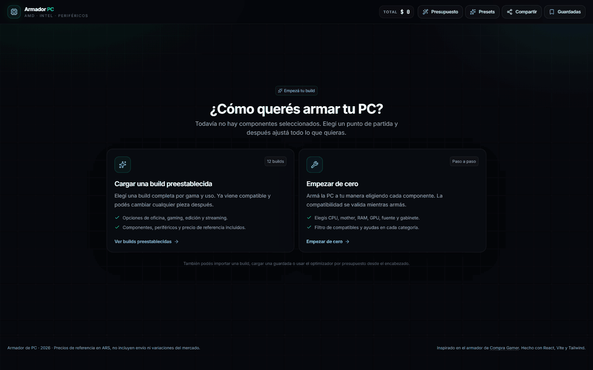
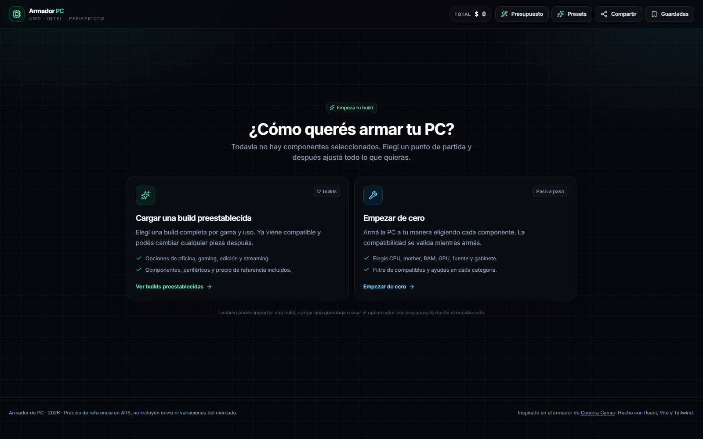
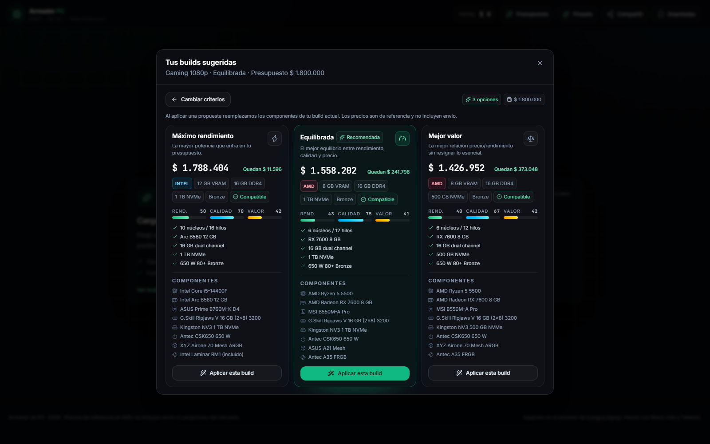
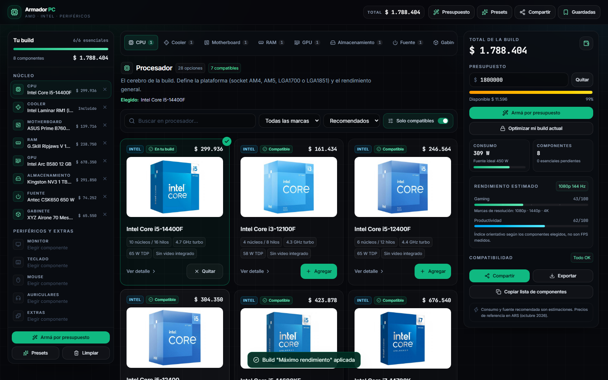

# 🖥️ Armador de PC

Armá tu PC pieza por pieza con validación de compatibilidad en tiempo real, o decile cuánto querés gastar y para qué la vas a usar: un optimizador te propone 2 o 3 builds completas que entran en tu presupuesto.

**[▶ Ejecutar localmente](#correrlo-localmente)** · **[🖼️ Ver capturas](#capturas-del-proyecto)** · Precios de referencia en ARS (octubre 2026)




## ¿Por qué lo hice?

Los armadores de PC de las tiendas validan lo básico (socket, formato), pero dejan pasar combinaciones problemáticas: fuentes justas, cuellos de botella, RAM en single channel, gabinetes donde la GPU no entra. Quise construir uno con validaciones más profundas y que, además de verificar, **sugiera** qué comprar según presupuesto y uso.

## Qué hace

- **Armá por presupuesto:** elegís monto, uso (gaming 1080p/1440p, edición, streaming, oficina) y preferencia (rendimiento, equilibrada, compacta). Devuelve 2 o 3 builds completas, compatibles y sin advertencias.
- **Optimizar mi build actual:** fijás las piezas que ya tenés y el motor completa o ajusta el resto dentro del presupuesto.
- **Motor de compatibilidad:** más de 12 reglas cruzadas (socket, RAM, formato, largo de GPU, altura de cooler, radiador, consumo vs. fuente, M.2/PCIe, salida de video, cuello de botella, etc.).
- **Catálogo de 149 piezas** AMD (AM4/AM5) e Intel (LGA1700/LGA1851) y **12 presets** por gama.
- **Compartir sin backend:** link, JSON, texto o archivo. Las builds guardadas viven en el navegador.

## Capturas del proyecto



<p align="center">
  
  
</p>

## Cómo funciona por dentro

**Optimizador.** Combina componentes con una búsqueda tipo *beam search*, descarta las combinaciones incompletas o incompatibles y rankea las sobrevivientes en tres perfiles: máximo rendimiento, equilibrada y mejor valor. Aplica reglas según el uso (por ejemplo, edición y streaming exigen 32 GB en dual channel y NVMe; con GPU dedicada se descartan chipsets de entrada como H610 o A520). Si el presupuesto no alcanza, muestra un mínimo orientativo.

**Piezas fijas.** Antes de buscar, valida que las piezas que ya elegiste cumplan el uso pedido. Si un conflicto solo se resolvería cambiando una pieza fija, lo explica y ofrece optimizar sin fijar en lugar de devolver una build con advertencias.

**Estado en la URL.** La build se serializa en base64url dentro del hash (`#b=...`), así que un link es una build completa, sin servidor. Al importar se validan categorías, IDs y límites de cada slot, por lo que un link viejo o manipulado no rompe la app.

## Decisiones técnicas y aprendizajes

<!-- TODO: completá con tu experiencia real. Ideas de qué contar (2-3 líneas cada una): -->

- **¿Por qué beam search y no fuerza bruta?** _(ej.: el espacio de combinaciones crece multiplicativamente con cada categoría; beam search lo acota y mantiene resultados buenos.)_
- **¿Por qué 100 % frontend?** _(ej.: cero costos de hosting, el link es la build, y el catálogo es chico y curado.)_
- **Lo más difícil:** _(ej.: que el optimizador y el motor de compatibilidad compartieran las mismas reglas sin duplicarlas.)_
- **Qué haría distinto / próximos pasos:** _(ej.: precios automáticos, benchmarks reales en lugar de un índice orientativo.)_

## Correrlo localmente

```bash
npm install
npm run dev      # http://localhost:5173
npm run build    # chequeo de tipos + build de producción
npm run lint     # oxlint
npm run test     # vitest: compatibilidad, optimizador, share e historial
```

## Estructura

```
src/
  components/   # Catalog, BuildPanel, Summary, OptimizerDialog, etc.
  data/         # catálogo curado, presets e imágenes
  lib/
    compat.ts       # motor de compatibilidad
    optimizer.ts    # builds por presupuesto (beam search)
    share.ts        # serialización base64url / JSON / texto
    useBuild.ts     # estado y persistencia
scripts/        # utilidades para refrescar datos de referencia
```

## Limitaciones

- Precios e índice de rendimiento son **orientativos**: no son FPS medidos ni stock real, y no incluyen envío.
- El catálogo prioriza piezas verificables sobre volumen; agregar modelos es sencillo desde `src/data/catalog.ts`.
- Windows 11 figura como licencia de referencia; también se puede usar Linux o Windows sin licencia.

## Créditos

Inspirado en el [armador de Compra Gamer](https://compragamer.com/armatupc). Las fotos de productos pertenecen a sus marcas y se usan solo como referencia visual.

---

Hecho por [@alobarros8](https://github.com/alobarros8) ·[ link a LinkedIn ](https://www.linkedin.com/in/alejandro-barros-57933a257/)
